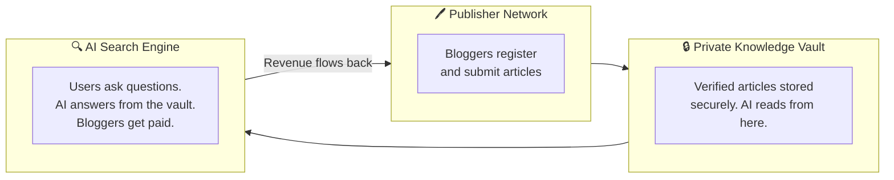
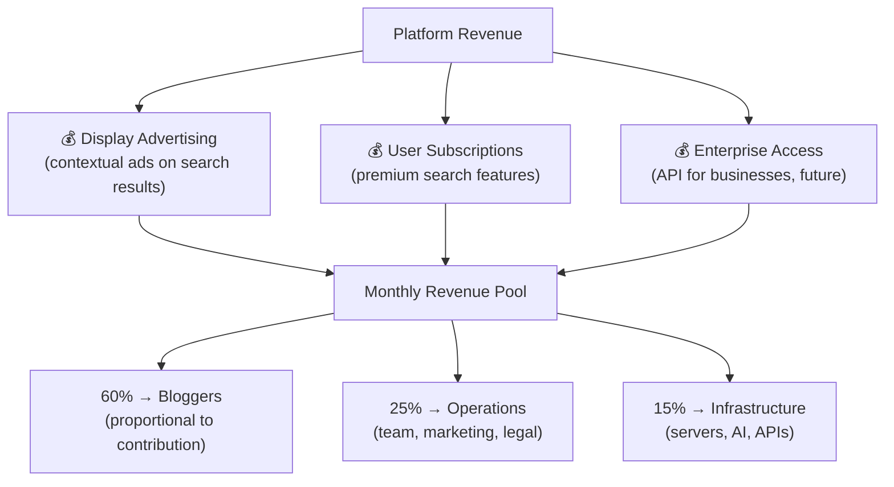
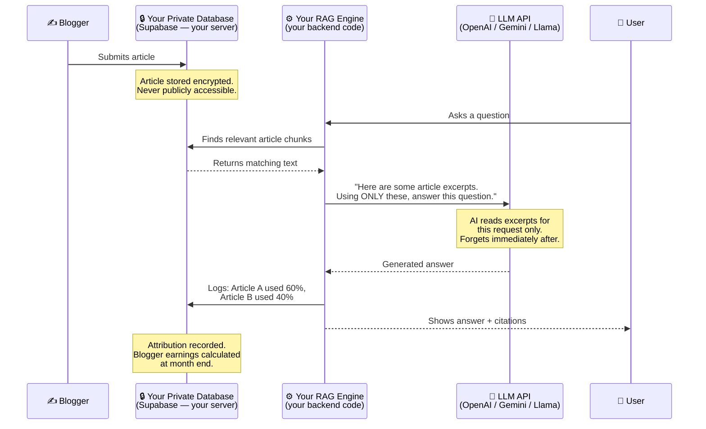
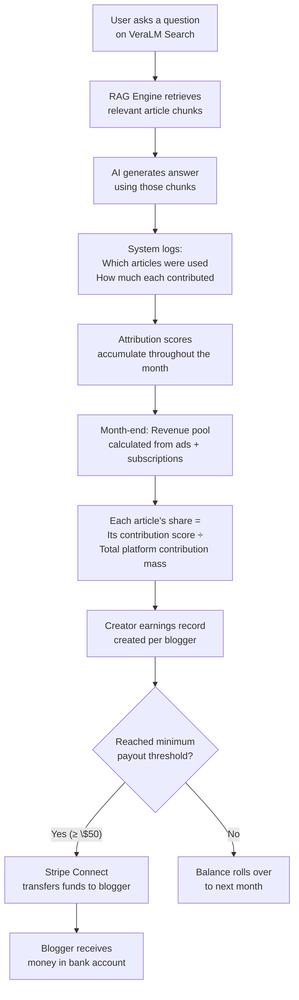
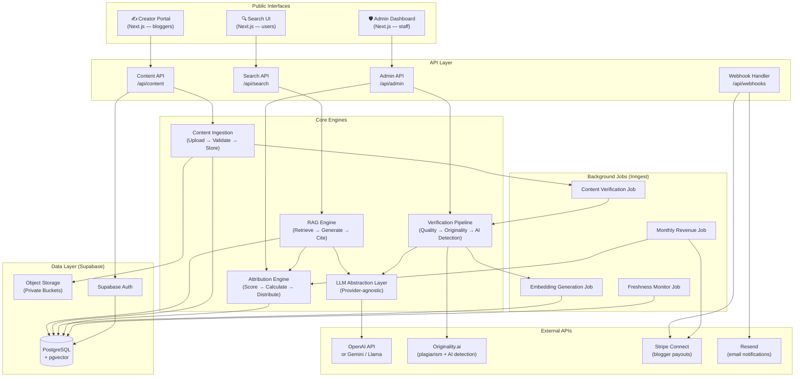
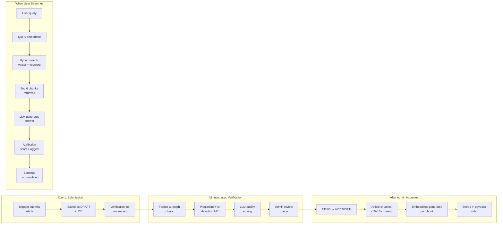
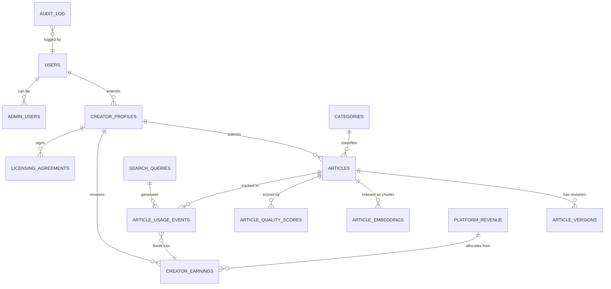
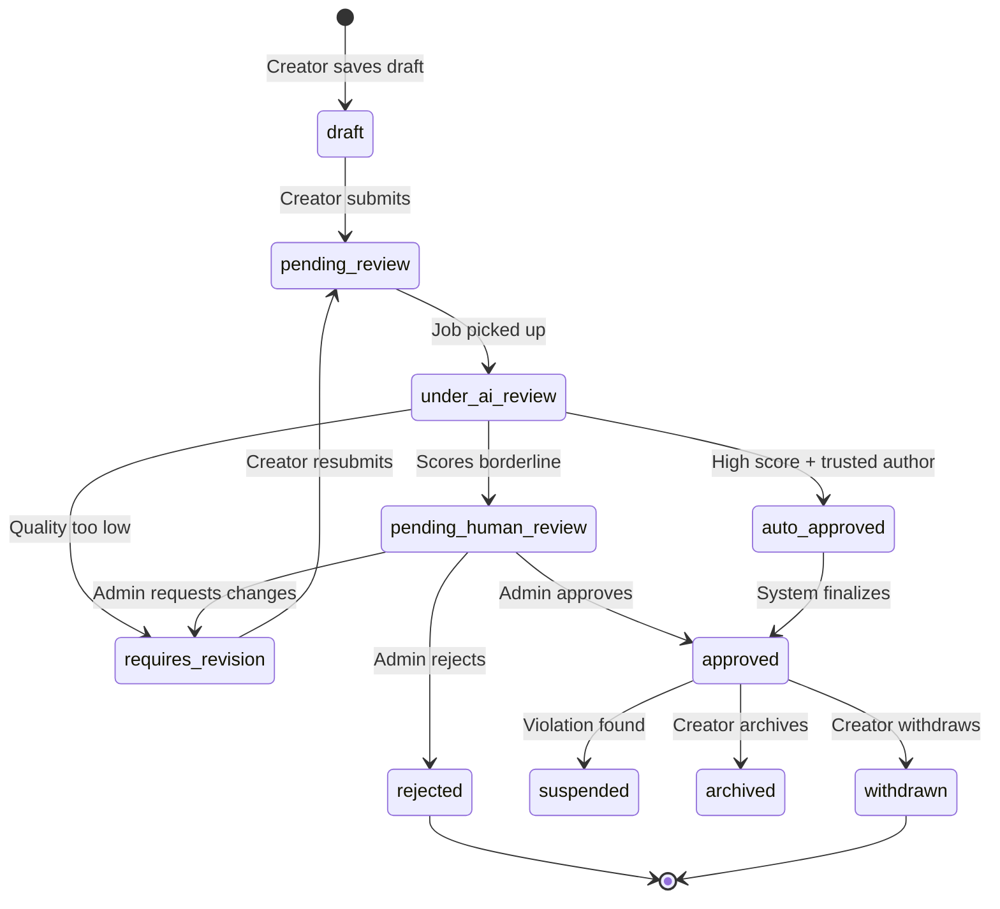
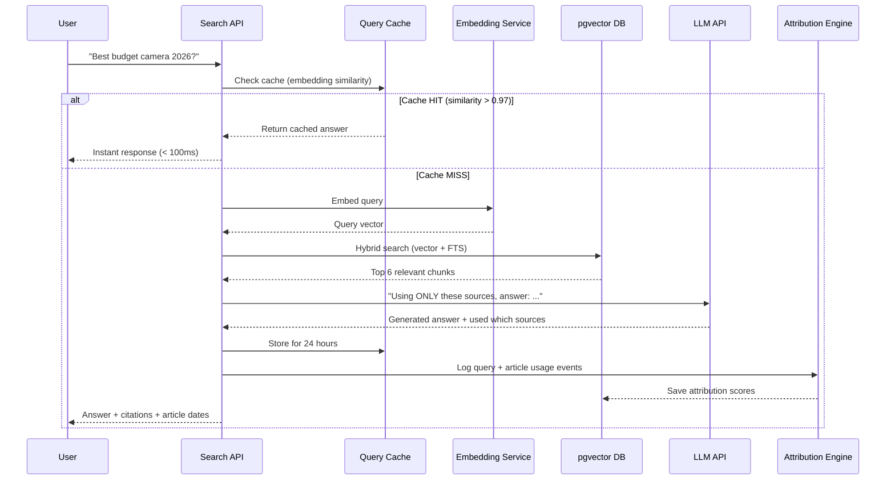
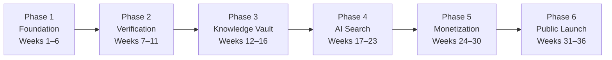

# VeraLM (veralm.com) — Complete Master Plan
## The AI Model with Real Human Answers & Creator Royalties

> **Brand:** VeraLM (`veralm.com`) · **AI Persona:** Vera · **Model:** Vera-LM
> **Version:** 3.0 · November 2026 · Official Blueprint & Master Reference Document

---

## 📋 Table of Contents

| # | Section |
|---|---|
| 1 | [What We Are Building](#1-what-we-are-building) |
| 2 | [How the Business Works](#2-how-the-business-works) |
| 3 | [How Blogger Content Is Used & Protected](#3-how-blogger-content-is-used--protected) |
| 4 | [How Bloggers Get Paid](#4-how-bloggers-get-paid) |
| 5 | [Platform Architecture](#5-platform-architecture) |
| 6 | [Complete Database Schema](#6-complete-database-schema) |
| 7 | [Content Verification Pipeline](#7-content-verification-pipeline) |
| 8 | [AI Search Engine (RAG)](#8-ai-search-engine-rag) |
| 9 | [Revenue Attribution System](#9-revenue-attribution-system) |
| 10 | [All Platform Screens & Features](#10-all-platform-screens--features) |
| 11 | [Technology Stack & Costs](#11-technology-stack--costs) |
| 12 | [Implementation Roadmap](#12-implementation-roadmap) |
| 13 | [Risks & Mitigations](#13-risks--mitigations) |
| 14 | [Legal Requirements](#14-legal-requirements) |
| 15 | [Launch Strategy](#15-launch-strategy) |

---

## 1. What We Are Building

### The One-Line Description
> An AI search engine where **every answer comes from verified, exclusively licensed articles written by real bloggers** — and every blogger gets paid when their knowledge is used to answer a question.

### Three Products in One



### Why This Exists

Traditional search sends users to blogs → bloggers earn ad revenue.

AI search answers questions directly → users never visit blogs → bloggers earn nothing.

**This platform creates a new model:** Bloggers contribute knowledge directly into a licensed vault. When that knowledge is used to answer a question, they earn a share of the platform's revenue. No traffic required.

---

## 2. How the Business Works

### Revenue Sources



### Unit Economics (Early Stage)

| Scenario | Monthly Searches | Revenue (ads + subs) | AI Cost | Creator Pool | Per-creator avg (50 creators) |
|---|---|---|---|---|---|
| Pre-launch | 500 | \$0 | \$0.25 | \$0 (flat fees) | — |
| Month 3 | 5,000 | \$200 | \$2.50 | \$120 | \$2.40 |
| Month 6 | 25,000 | \$1,200 | \$12 | \$720 | \$14.40 |
| Month 12 | 100,000 | \$5,000 | \$50 | \$3,000 | \$60 |
| Year 2 | 500,000 | \$25,000 | \$250 | \$15,000 | \$300 |

> [!NOTE]
> Early creators earn modest amounts. The proposition is long-term: as the platform grows, early contributors earn more because they have the most indexed content. First movers benefit most.

---

## 3. How Blogger Content Is Used & Protected

### The Critical Architecture (Read This First)



### What OpenAI/Gemini Never Receives

| Data | Sent to AI? |
|---|---|
| Full article text | ❌ Never |
| Blogger's personal information | ❌ Never |
| Other users' queries | ❌ Never |
| Revenue or financial data | ❌ Never |
| Blogger account details | ❌ Never |

### What OpenAI/Gemini Does Receive (Temporarily, Per Query)

| Data | Sent to AI? | Retained by AI? |
|---|---|---|
| Relevant excerpt chunks (max 6 × 500 words) | ✅ Yes | ❌ No |
| The user's search question | ✅ Yes | ❌ No |
| System instructions | ✅ Yes | ❌ No |

> [!IMPORTANT]
> API calls are **excluded from OpenAI/Google model training** by their standard data policies. Your bloggers' content is not feeding future ChatGPT or Gemini models. It is used only to process the specific query in that moment.

### Content Security Layers

```
Layer 1: Database encryption at rest (Supabase AES-256)
Layer 2: TLS 1.3 encryption in transit
Layer 3: Row Level Security (RLS) policies — no direct public access
Layer 4: Service role key only used server-side (never in browser)
Layer 5: No public API endpoint that returns full article text
Layer 6: Rate limiting on all endpoints
Layer 7: Signed URLs for any file access (expire in minutes)
Layer 8: Audit log of every access to content
```

---

## 4. How Bloggers Get Paid

### The Complete Payout Flow



### Contribution Score Formula

For each search query, every article used receives a score:

```
Contribution Score =
  (Retrieval Rank Score  × 30%) +   ← Was it #1 or #5 most relevant?
  (Semantic Relevance    × 35%) +   ← How closely did it match the question?
  (Citation Bonus        × 25%) +   ← Was it explicitly cited in the answer?
  (Usage Ratio           × 10%)     ← What fraction of used chunks came from this article?

× Quality Multiplier (0.7–1.3)      ← Better quality = higher earnings
× Freshness Multiplier (0.5–1.0)    ← Outdated articles earn less
```

### Monthly Earnings Example

Suppose platform earns \$5,000 this month. Creator pool = \$3,000 (60%).

| Blogger | Articles | Query Contributions | Contribution Share | Earnings |
|---|---|---|---|---|
| Alice (tech) | 12 articles | 2,400 contributions | 32% | **\$960** |
| Bob (travel) | 8 articles | 1,200 contributions | 16% | **\$480** |
| Carol (finance) | 5 articles | 900 contributions | 12% | **\$360** |
| Others (40 bloggers) | varied | 3,000 contributions | 40% | **\$1,200** |

### Blogger Dashboard View

Every creator sees in real time:

| Widget | What It Shows |
|---|---|
| **This Month's Earnings** | Real-time estimate, updated daily |
| **Confirmed Earnings** | End-of-month locked amount |
| **Payout History** | All previous payments with dates |
| **Article Leaderboard** | Which articles earned most |
| **Query Contributions** | How many questions your articles answered |
| **Quality Scores** | Each article's editorial score |
| **Freshness Status** | Which articles need updating |
| **Next Payout Date** | Countdown to next payment run |

---

## 5. Platform Architecture

### High-Level System Map



### Data Flow: Article Submission to AI Answer



---

## 6. Complete Database Schema

### Entity Relationship Overview



### Full SQL Schema

```sql
-- ============================================================
-- EXTENSIONS
-- ============================================================
CREATE EXTENSION IF NOT EXISTS "uuid-ossp";
CREATE EXTENSION IF NOT EXISTS "vector";
CREATE EXTENSION IF NOT EXISTS "pg_trgm";

-- ============================================================
-- USERS
-- ============================================================
CREATE TABLE users (
    id          UUID PRIMARY KEY DEFAULT uuid_generate_v4(),
    email       TEXT UNIQUE NOT NULL,
    role        TEXT NOT NULL DEFAULT 'creator'
                  CHECK (role IN ('creator', 'admin', 'superadmin')),
    is_active   BOOLEAN DEFAULT TRUE,
    last_sign_in TIMESTAMPTZ,
    created_at  TIMESTAMPTZ DEFAULT NOW(),
    updated_at  TIMESTAMPTZ DEFAULT NOW()
);

-- ============================================================
-- CATEGORIES
-- ============================================================
CREATE TABLE categories (
    id          UUID PRIMARY KEY DEFAULT uuid_generate_v4(),
    name        TEXT UNIQUE NOT NULL,
    slug        TEXT UNIQUE NOT NULL,
    description TEXT,
    parent_id   UUID REFERENCES categories(id),
    icon        TEXT,
    sort_order  INTEGER DEFAULT 0,
    is_active   BOOLEAN DEFAULT TRUE,
    created_at  TIMESTAMPTZ DEFAULT NOW()
);

-- Seed initial categories
INSERT INTO categories (name, slug) VALUES
  ('Technology', 'technology'),
  ('Personal Finance', 'personal-finance'),
  ('Health & Wellness', 'health-wellness'),
  ('Travel', 'travel'),
  ('Food & Cooking', 'food-cooking'),
  ('Business', 'business'),
  ('Science', 'science'),
  ('Education', 'education');

-- ============================================================
-- CREATOR PROFILES
-- ============================================================
CREATE TABLE creator_profiles (
    id                      UUID PRIMARY KEY DEFAULT uuid_generate_v4(),
    user_id                 UUID UNIQUE NOT NULL REFERENCES users(id) ON DELETE CASCADE,
    display_name            TEXT NOT NULL,
    slug                    TEXT UNIQUE NOT NULL,
    bio                     TEXT,
    country                 TEXT,
    website_url             TEXT,
    profile_image_url       TEXT,
    social_links            JSONB DEFAULT '{}',   -- {twitter, linkedin, etc}

    -- Expertise
    primary_categories      TEXT[] DEFAULT '{}',
    qualifications          TEXT,
    years_of_experience     INTEGER,

    -- Verification
    identity_verified       BOOLEAN DEFAULT FALSE,
    verification_method     TEXT,
    verified_at             TIMESTAMPTZ,

    -- Reputation (computed nightly)
    reputation_score        DECIMAL(5,2) DEFAULT 0.00,
    reputation_tier         TEXT DEFAULT 'new'
                              CHECK (reputation_tier IN (
                                'new', 'contributor', 'established', 'expert', 'suspended'
                              )),
    total_articles_approved INTEGER DEFAULT 0,
    total_query_contributions INTEGER DEFAULT 0,
    total_lifetime_earnings DECIMAL(10,4) DEFAULT 0,

    -- Payment
    stripe_account_id       TEXT,     -- Stripe Connect Express account ID
    payment_email           TEXT,
    minimum_payout          DECIMAL(10,2) DEFAULT 50.00,
    tax_country             TEXT,
    tax_id                  TEXT,     -- Encrypted

    -- Account flags
    is_active               BOOLEAN DEFAULT TRUE,
    suspension_reason       TEXT,
    suspended_at            TIMESTAMPTZ,
    onboarding_completed    BOOLEAN DEFAULT FALSE,
    agreed_to_terms_at      TIMESTAMPTZ,

    created_at              TIMESTAMPTZ DEFAULT NOW(),
    updated_at              TIMESTAMPTZ DEFAULT NOW()
);

CREATE INDEX idx_creator_slug ON creator_profiles(slug);
CREATE INDEX idx_creator_reputation ON creator_profiles(reputation_score DESC);

-- ============================================================
-- LICENSING AGREEMENTS (legal record of every agreement signed)
-- ============================================================
CREATE TABLE licensing_agreements (
    id                  UUID PRIMARY KEY DEFAULT uuid_generate_v4(),
    creator_id          UUID NOT NULL REFERENCES creator_profiles(id),
    agreement_version   TEXT NOT NULL,          -- e.g. 'v1.2'
    agreed_at           TIMESTAMPTZ NOT NULL DEFAULT NOW(),
    agreement_text_hash TEXT NOT NULL,          -- SHA-256 of agreement text
    ip_address          INET,
    user_agent          TEXT,
    is_current          BOOLEAN DEFAULT TRUE,   -- Most recent agreement
    revoked_at          TIMESTAMPTZ
);

-- ============================================================
-- ARTICLES
-- ============================================================
CREATE TABLE articles (
    id                      UUID PRIMARY KEY DEFAULT uuid_generate_v4(),
    creator_id              UUID NOT NULL REFERENCES creator_profiles(id),
    category_id             UUID REFERENCES categories(id),

    -- Content
    title                   TEXT NOT NULL,
    slug                    TEXT UNIQUE NOT NULL,
    content                 TEXT NOT NULL,          -- Full text (server-side only)
    content_format          TEXT DEFAULT 'markdown'
                              CHECK (content_format IN ('markdown', 'html', 'richtext')),
    excerpt                 TEXT,                   -- Max 200 chars. Safe for public display.
    word_count              INTEGER,

    -- Metadata
    tags                    TEXT[] DEFAULT '{}',
    author_notes            TEXT,
    target_audience         TEXT,
    references_json         JSONB DEFAULT '[]',
    -- [{title, url, publisher, accessed_date, is_primary}]
    images_json             JSONB DEFAULT '[]',
    -- [{storage_key, caption, rights_cleared, source_url}]
    source_links            JSONB DEFAULT '[]',

    -- Dates
    original_created_at     TIMESTAMPTZ,
    submitted_at            TIMESTAMPTZ DEFAULT NOW(),
    approved_at             TIMESTAMPTZ,
    last_reviewed_at        TIMESTAMPTZ,
    expires_at              TIMESTAMPTZ,            -- When exclusivity expires

    -- Status workflow
    status                  TEXT NOT NULL DEFAULT 'pending_review'
                              CHECK (status IN (
                                'draft',
                                'pending_review',
                                'under_ai_review',
                                'requires_revision',
                                'approved',
                                'rejected',
                                'suspended',
                                'archived',
                                'withdrawn'
                              )),
    rejection_reason        TEXT,
    revision_instructions   TEXT,
    reviewed_by             UUID REFERENCES users(id),

    -- Quality scores (summary — detail in article_quality_scores)
    composite_quality_score DECIMAL(5,2),
    originality_score       DECIMAL(5,2),
    ai_probability_score    DECIMAL(5,2),

    -- Licensing
    licensing_status        TEXT DEFAULT 'pending'
                              CHECK (licensing_status IN (
                                'pending', 'active', 'expired', 'withdrawn'
                              )),
    license_type            TEXT DEFAULT 'exclusive_ai_search',
    licensing_agreement_id  UUID REFERENCES licensing_agreements(id),

    -- Versioning
    version_number          INTEGER DEFAULT 1,

    -- Freshness monitoring
    freshness_status        TEXT DEFAULT 'current'
                              CHECK (freshness_status IN (
                                'current', 'aging', 'outdated', 'flagged', 'superseded'
                              )),
    freshness_checked_at    TIMESTAMPTZ,
    freshness_notes         TEXT,

    -- Performance (updated by triggers)
    total_query_contributions   INTEGER DEFAULT 0,
    total_earnings_attributed   DECIMAL(10,4) DEFAULT 0,

    -- Full-text search (auto-updated by trigger)
    search_vector           TSVECTOR,

    created_at              TIMESTAMPTZ DEFAULT NOW(),
    updated_at              TIMESTAMPTZ DEFAULT NOW()
);

-- Full-text search trigger
CREATE OR REPLACE FUNCTION articles_fts_update() RETURNS TRIGGER AS $$
BEGIN
    NEW.search_vector :=
        setweight(to_tsvector('english', COALESCE(NEW.title, '')), 'A') ||
        setweight(to_tsvector('english', COALESCE(array_to_string(NEW.tags, ' '), '')), 'B') ||
        setweight(to_tsvector('english', COALESCE(NEW.excerpt, '')), 'C') ||
        setweight(to_tsvector('english', COALESCE(NEW.content, '')), 'D');
    RETURN NEW;
END;
$$ LANGUAGE plpgsql;

CREATE TRIGGER trigger_articles_fts
BEFORE INSERT OR UPDATE OF title, tags, excerpt, content
ON articles FOR EACH ROW EXECUTE FUNCTION articles_fts_update();

-- Indexes
CREATE INDEX idx_articles_status ON articles(status);
CREATE INDEX idx_articles_creator ON articles(creator_id);
CREATE INDEX idx_articles_category ON articles(category_id);
CREATE INDEX idx_articles_approved ON articles(approved_at DESC)
  WHERE status = 'approved';
CREATE INDEX idx_articles_fts ON articles USING GIN(search_vector);
CREATE INDEX idx_articles_tags ON articles USING GIN(tags);

-- ============================================================
-- ARTICLE VERSIONS (revision history)
-- ============================================================
CREATE TABLE article_versions (
    id              UUID PRIMARY KEY DEFAULT uuid_generate_v4(),
    article_id      UUID NOT NULL REFERENCES articles(id) ON DELETE CASCADE,
    version_number  INTEGER NOT NULL,
    title           TEXT NOT NULL,
    content         TEXT NOT NULL,
    change_summary  TEXT,
    changed_by      UUID REFERENCES users(id),
    created_at      TIMESTAMPTZ DEFAULT NOW(),
    UNIQUE(article_id, version_number)
);

-- ============================================================
-- ARTICLE EMBEDDINGS (vector index — the RAG heart)
-- ============================================================
CREATE TABLE article_embeddings (
    id                  UUID PRIMARY KEY DEFAULT uuid_generate_v4(),
    article_id          UUID NOT NULL REFERENCES articles(id) ON DELETE CASCADE,
    chunk_index         INTEGER NOT NULL,
    chunk_text          TEXT NOT NULL,          -- The actual chunk (retrieved during RAG)
    chunk_heading       TEXT,                   -- Section heading if available
    is_intro_chunk      BOOLEAN DEFAULT FALSE,
    embedding           VECTOR(1536),           -- text-embedding-3-small dimensions
    embedding_model     TEXT DEFAULT 'text-embedding-3-small',
    embedding_version   INTEGER DEFAULT 1,
    token_count         INTEGER,
    created_at          TIMESTAMPTZ DEFAULT NOW(),
    UNIQUE(article_id, chunk_index)
);

-- HNSW vector index (approximate nearest neighbor — fast)
CREATE INDEX idx_embeddings_hnsw ON article_embeddings
  USING hnsw(embedding vector_cosine_ops)
  WITH (m = 16, ef_construction = 64);

-- ============================================================
-- ARTICLE QUALITY SCORES (detailed breakdown)
-- ============================================================
CREATE TABLE article_quality_scores (
    id                      UUID PRIMARY KEY DEFAULT uuid_generate_v4(),
    article_id              UUID UNIQUE NOT NULL REFERENCES articles(id) ON DELETE CASCADE,

    -- Automated scores (0-100 each)
    originality_score       DECIMAL(5,2),
    plagiarism_score        DECIMAL(5,2),       -- 100 = fully original
    plagiarism_report       JSONB,
    ai_probability_score    DECIMAL(5,2),       -- 0 = human, 100 = AI
    ai_detection_report     JSONB,
    factual_accuracy_score  DECIMAL(5,2),
    usefulness_score        DECIMAL(5,2),
    depth_score             DECIMAL(5,2),
    clarity_score           DECIMAL(5,2),
    reference_quality_score DECIMAL(5,2),
    author_credibility_score DECIMAL(5,2),
    freshness_score         DECIMAL(5,2),

    -- Weighted composite (see formula in plan)
    composite_score         DECIMAL(5,2),

    -- LLM evaluation response
    llm_evaluation          JSONB,              -- Full LLM quality assessment JSON
    llm_model_used          TEXT,

    -- Human override
    human_reviewed          BOOLEAN DEFAULT FALSE,
    reviewer_id             UUID REFERENCES users(id),
    reviewer_notes          TEXT,
    human_score_override    DECIMAL(5,2),
    reviewed_at             TIMESTAMPTZ,

    created_at              TIMESTAMPTZ DEFAULT NOW(),
    updated_at              TIMESTAMPTZ DEFAULT NOW()
);

-- ============================================================
-- SEARCH QUERIES (every query logged for attribution)
-- ============================================================
CREATE TABLE search_queries (
    id                  UUID PRIMARY KEY DEFAULT uuid_generate_v4(),
    session_id          TEXT NOT NULL,
    user_id             UUID REFERENCES users(id),  -- NULL = anonymous
    query_text          TEXT NOT NULL,
    query_embedding     VECTOR(1536),
    category_filter     UUID REFERENCES categories(id),
    date_filter_from    TIMESTAMPTZ,

    -- Response
    response_text       TEXT,
    response_tokens     INTEGER,
    prompt_tokens       INTEGER,
    latency_ms          INTEGER,
    model_used          TEXT,
    was_cached          BOOLEAN DEFAULT FALSE,

    -- Quick reference
    articles_cited      UUID[] DEFAULT '{}',

    -- Revenue tracking
    revenue_period      TEXT,                   -- 'YYYY-MM'
    ad_impression_count INTEGER DEFAULT 0,
    subscription_query  BOOLEAN DEFAULT FALSE,

    -- Quality signals
    user_rating         SMALLINT CHECK (user_rating IN (1, -1)),
    has_follow_up       BOOLEAN DEFAULT FALSE,

    created_at          TIMESTAMPTZ DEFAULT NOW()
);

CREATE INDEX idx_queries_session ON search_queries(session_id);
CREATE INDEX idx_queries_period ON search_queries(revenue_period);
CREATE INDEX idx_queries_created ON search_queries(created_at DESC);

-- ============================================================
-- ARTICLE USAGE EVENTS (granular attribution — the revenue engine)
-- ============================================================
CREATE TABLE article_usage_events (
    id                  UUID PRIMARY KEY DEFAULT uuid_generate_v4(),
    query_id            UUID NOT NULL REFERENCES search_queries(id),
    article_id          UUID NOT NULL REFERENCES articles(id),
    creator_id          UUID NOT NULL REFERENCES creator_profiles(id),

    -- Retrieval signals
    retrieval_rank      INTEGER NOT NULL,
    cosine_similarity   DECIMAL(6,4),
    bm25_score          DECIMAL(10,4),
    hybrid_score        DECIMAL(6,4),

    -- Attribution
    contribution_score  DECIMAL(6,4) DEFAULT 0,     -- Raw score (pre-normalization)
    contribution_weight DECIMAL(6,4) DEFAULT 0,     -- Normalized share (0.0–1.0)
    was_primary_source  BOOLEAN DEFAULT FALSE,
    was_cited           BOOLEAN DEFAULT FALSE,
    chunks_used         INTEGER DEFAULT 0,

    -- Revenue (populated in monthly distribution run)
    revenue_period      TEXT,
    attributed_revenue  DECIMAL(10,6) DEFAULT 0,

    created_at          TIMESTAMPTZ DEFAULT NOW()
);

CREATE INDEX idx_usage_article ON article_usage_events(article_id);
CREATE INDEX idx_usage_creator ON article_usage_events(creator_id);
CREATE INDEX idx_usage_period ON article_usage_events(revenue_period);
CREATE INDEX idx_usage_query ON article_usage_events(query_id);

-- ============================================================
-- PLATFORM REVENUE (monthly financial record)
-- ============================================================
CREATE TABLE platform_revenue (
    id                      UUID PRIMARY KEY DEFAULT uuid_generate_v4(),
    revenue_period          TEXT UNIQUE NOT NULL,       -- 'YYYY-MM'

    -- Gross revenue by source
    ad_revenue              DECIMAL(12,4) DEFAULT 0,
    subscription_revenue    DECIMAL(12,4) DEFAULT 0,
    enterprise_revenue      DECIMAL(12,4) DEFAULT 0,
    other_revenue           DECIMAL(12,4) DEFAULT 0,
    gross_revenue           DECIMAL(12,4) DEFAULT 0,

    -- Costs (documented for transparency)
    infrastructure_cost     DECIMAL(12,4) DEFAULT 0,
    ai_inference_cost       DECIMAL(12,4) DEFAULT 0,
    payment_processing_cost DECIMAL(12,4) DEFAULT 0,
    plagiarism_api_cost     DECIMAL(12,4) DEFAULT 0,
    other_costs             DECIMAL(12,4) DEFAULT 0,

    -- Creator distribution
    creator_pool            DECIMAL(12,4) DEFAULT 0,
    creator_pool_pct        DECIMAL(5,2) DEFAULT 60.00,

    -- Status
    status      TEXT DEFAULT 'open'
                  CHECK (status IN ('open', 'calculating', 'closed', 'audited')),
    closed_at   TIMESTAMPTZ,
    created_at  TIMESTAMPTZ DEFAULT NOW(),
    updated_at  TIMESTAMPTZ DEFAULT NOW()
);

-- ============================================================
-- CREATOR EARNINGS (one record per creator per month)
-- ============================================================
CREATE TABLE creator_earnings (
    id                          UUID PRIMARY KEY DEFAULT uuid_generate_v4(),
    creator_id                  UUID NOT NULL REFERENCES creator_profiles(id),
    revenue_period              TEXT NOT NULL,          -- 'YYYY-MM'
    platform_revenue_id         UUID REFERENCES platform_revenue(id),

    -- Contribution
    total_query_contributions   INTEGER DEFAULT 0,
    total_contribution_weight   DECIMAL(10,6) DEFAULT 0,
    contribution_share_pct      DECIMAL(8,4),           -- Their % of total pool

    -- Earnings
    creator_gross_earnings      DECIMAL(12,4) DEFAULT 0,
    payment_processing_fee      DECIMAL(12,4) DEFAULT 0,
    tax_withholding             DECIMAL(12,4) DEFAULT 0,
    creator_net_earnings        DECIMAL(12,4) DEFAULT 0,

    -- Payout
    status          TEXT DEFAULT 'calculating'
                      CHECK (status IN (
                        'calculating', 'confirmed', 'pending_payout',
                        'paid', 'disputed', 'on_hold', 'below_threshold'
                      )),
    confirmed_at    TIMESTAMPTZ,
    paid_at         TIMESTAMPTZ,
    stripe_payout_id TEXT,
    stripe_transfer_id TEXT,

    -- Metadata
    article_count               INTEGER,
    calculation_version         INTEGER DEFAULT 1,
    notes                       TEXT,

    created_at  TIMESTAMPTZ DEFAULT NOW(),
    updated_at  TIMESTAMPTZ DEFAULT NOW(),
    UNIQUE(creator_id, revenue_period)
);

-- ============================================================
-- AUDIT LOG (every admin action recorded)
-- ============================================================
CREATE TABLE audit_log (
    id              BIGSERIAL PRIMARY KEY,
    actor_id        UUID REFERENCES users(id),
    actor_role      TEXT,
    action          TEXT NOT NULL,
    -- e.g. 'article.approve', 'article.reject', 'creator.suspend',
    --      'revenue.distribute', 'payout.process'
    entity_type     TEXT NOT NULL,
    entity_id       UUID,
    before_state    JSONB,
    after_state     JSONB,
    metadata        JSONB,
    ip_address      INET,
    created_at      TIMESTAMPTZ DEFAULT NOW()
);

CREATE INDEX idx_audit_actor ON audit_log(actor_id);
CREATE INDEX idx_audit_entity ON audit_log(entity_type, entity_id);
CREATE INDEX idx_audit_action ON audit_log(action);
CREATE INDEX idx_audit_created ON audit_log(created_at DESC);

-- ============================================================
-- QUERY CACHE (reduce LLM costs for repeated questions)
-- ============================================================
CREATE TABLE query_cache (
    id                  UUID PRIMARY KEY DEFAULT uuid_generate_v4(),
    query_hash          TEXT UNIQUE NOT NULL,       -- Hash of normalized query
    query_embedding     VECTOR(1536),
    cached_response     TEXT NOT NULL,
    articles_cited      UUID[] DEFAULT '{}',
    model_used          TEXT,
    hit_count           INTEGER DEFAULT 1,
    expires_at          TIMESTAMPTZ NOT NULL,       -- 24 hours from creation
    created_at          TIMESTAMPTZ DEFAULT NOW()
);

CREATE INDEX idx_cache_hash ON query_cache(query_hash);
CREATE INDEX idx_cache_expires ON query_cache(expires_at);
CREATE INDEX idx_cache_embedding ON query_cache
  USING hnsw(query_embedding vector_cosine_ops);

-- ============================================================
-- ROW LEVEL SECURITY POLICIES
-- ============================================================
ALTER TABLE articles ENABLE ROW LEVEL SECURITY;
ALTER TABLE creator_profiles ENABLE ROW LEVEL SECURITY;
ALTER TABLE creator_earnings ENABLE ROW LEVEL SECURITY;
ALTER TABLE article_embeddings ENABLE ROW LEVEL SECURITY;

-- Creators can only see their own articles
CREATE POLICY "Creators see own articles"
  ON articles FOR SELECT
  USING (creator_id = (
    SELECT id FROM creator_profiles WHERE user_id = auth.uid()
  ));

-- Public can see only approved article metadata (not full content)
CREATE POLICY "Public sees approved article metadata"
  ON articles FOR SELECT
  USING (status = 'approved')
  WITH CHECK (FALSE);  -- No public INSERT/UPDATE

-- Embeddings: internal service only (use service_role key, never anon key)
CREATE POLICY "No public embedding access"
  ON article_embeddings FOR ALL
  USING (FALSE);  -- Blocked for all non-service-role access
```

---

## 7. Content Verification Pipeline

### Pipeline State Machine



### Stage-by-Stage Detail

#### Stage 1 — Format Validation (< 1 second, synchronous)
```
✅ Minimum 500 words
✅ Title present (10–200 characters)
✅ Category selected
✅ At least 1 tag
✅ Excerpt provided or auto-generated
✅ Licensing agreement is current and signed
✅ No HTML injection in content
✅ Image rights declared if images included
```

#### Stage 2 — Internal Duplicate Detection (10–30 seconds)
```
1. Embed first 2,000 words of new article
2. Query pgvector for articles with cosine similarity > 0.90
3. If match found:
   - Flag for human review (not auto-reject)
   - Show admin: "Similar to [Article Title] by [Author] (92% similar)"
4. Also check title similarity using pg_trgm
```

#### Stage 3 — External Originality Check (30–60 seconds)
```
API: Originality.ai (or Copyleaks fallback)
Checks:
  - Web plagiarism scan
  - AI-generated content probability
  - Sentence-level flagging

Thresholds (configurable):
  - Plagiarism score > 20% → Flag for human review
  - AI probability > 70% → Flag for human review (NOT auto-reject)
  - AI probability > 90% → Requires revision with explanation
```

#### Stage 4 — LLM Quality Assessment (20–40 seconds)

```
Model: gpt-4o-mini (cost ~$0.0003 per article)
Prompt evaluates:
  - Usefulness (0-100): Does this answer real questions?
  - Depth (0-100): Does it go beyond surface-level?
  - Clarity (0-100): Is it well-structured and readable?
  - Factual confidence (0-100): Are claims supported?
  - Reference quality (0-100): Are citations credible?
  - Original contribution (0-100): Does it add new value?

Returns JSON with scores + specific feedback
```

#### Stage 5 — Composite Score & Routing

```
Composite = 
  originality    × 0.25 +
  factual        × 0.25 +
  usefulness     × 0.20 +
  author_rep     × 0.15 +
  writing        × 0.10 +
  freshness      × 0.05

Routing:
  Score ≥ 80 AND reputation = 'expert'   → Auto-approve
  Score ≥ 65                             → Human review queue (priority: low)
  Score 50–64                            → Human review queue (priority: high)
  Score < 50                             → Requires revision (automated feedback sent)
```

### Verification Cost Per Article

| Step | Service | Cost |
|---|---|---|
| Embedding (duplicate check) | OpenAI | \$0.00005 |
| Originality + AI detection | Originality.ai | \$0.010 |
| LLM quality scoring | gpt-4o-mini | \$0.0003 |
| Embedding (indexing, 10 chunks) | OpenAI | \$0.0002 |
| **Total per article** | | **~\$0.011** |

**1,000 articles verified = ~\$11.00**

---

## 8. AI Search Engine (RAG)

### How Every Search Works



### Retrieval Query (Hybrid Search)

```sql
-- Step 1: Semantic search
WITH semantic AS (
    SELECT
        ae.article_id,
        ae.chunk_text,
        ae.chunk_index,
        a.title,
        a.creator_id,
        a.approved_at,
        a.quality_score,
        a.freshness_status,
        1 - (ae.embedding <=> $1::vector) AS score,
        ROW_NUMBER() OVER (ORDER BY ae.embedding <=> $1::vector) AS rank
    FROM article_embeddings ae
    JOIN articles a ON ae.article_id = a.id
    WHERE a.status = 'approved'
      AND a.licensing_status = 'active'
      AND a.freshness_status NOT IN ('outdated', 'withdrawn')
    ORDER BY ae.embedding <=> $1::vector
    LIMIT 20
),
-- Step 2: Keyword search
keyword AS (
    SELECT
        ae.article_id,
        ae.chunk_text,
        ae.chunk_index,
        a.title,
        a.creator_id,
        a.approved_at,
        a.quality_score,
        a.freshness_status,
        ts_rank(a.search_vector, plainto_tsquery('english', $2)) AS score,
        ROW_NUMBER() OVER (
            ORDER BY ts_rank(a.search_vector, plainto_tsquery('english', $2)) DESC
        ) AS rank
    FROM articles a
    JOIN article_embeddings ae ON ae.article_id = a.id AND ae.chunk_index = 0
    WHERE a.status = 'approved'
      AND a.search_vector @@ plainto_tsquery('english', $2)
    LIMIT 20
),
-- Step 3: Reciprocal Rank Fusion (RRF merge)
merged AS (
    SELECT
        COALESCE(s.article_id, k.article_id) AS article_id,
        COALESCE(s.chunk_text, k.chunk_text) AS chunk_text,
        COALESCE(s.title, k.title) AS title,
        COALESCE(s.creator_id, k.creator_id) AS creator_id,
        COALESCE(s.approved_at, k.approved_at) AS approved_at,
        COALESCE(s.quality_score, k.quality_score) AS quality_score,
        COALESCE(s.freshness_status, k.freshness_status) AS freshness_status,
        COALESCE(s.score, 0) AS semantic_score,
        COALESCE(k.score, 0) AS keyword_score,
        (1.0/(60 + COALESCE(s.rank, 999)) + 1.0/(60 + COALESCE(k.rank, 999))) AS rrf_score
    FROM semantic s
    FULL OUTER JOIN keyword k ON s.article_id = k.article_id
)
SELECT * FROM merged
ORDER BY rrf_score DESC
LIMIT 6;
```

### System Prompt (Guides AI Answers)

```
You are a search assistant for VeraLM, an exclusive knowledge platform.

RULES — follow strictly:
1. Answer ONLY using information from the provided source articles.
2. If sources lack sufficient information, say exactly:
   "I don't have enough verified information in my knowledge base to answer this fully."
3. Clearly distinguish between: verified facts | author opinions | personal experiences | predictions.
4. If sources disagree with each other, acknowledge the disagreement explicitly.
5. Cite sources using format: [Article Title — Author Name, Month YYYY]
6. Never invent, extrapolate, or add information not in the sources.
7. If an article is marked 'aging' or 'outdated', note that it may need updating.
8. Prioritize recent articles over older ones when information conflicts.

TONE: Helpful, clear, factual. No marketing language. No speculation.
```

### Answer Display (User-Facing)

```
┌─────────────────────────────────────────────────────────────┐
│ 🔍 "Best budget camera 2026?"                               │
├─────────────────────────────────────────────────────────────┤
│                                                             │
│  Based on verified reviews in our knowledge base, the       │
│  top budget cameras in 2026 are...                         │
│                                                             │
│  [1] The Sony ZV-E10 II leads for video quality under       │
│  $500, with improved autofocus compared to its              │
│  predecessor. [Camera Reviews Weekly — James Liu, Oct 2026] │
│                                                             │
│  [2] For stills, the Fujifilm X-S20 offers superior         │
│  jpeg quality out of camera... [Budget Photo Guide — Sarah  │
│  Chen, Sep 2026]                                           │
│                                                             │
├─────────────────────────────────────────────────────────────┤
│ Sources used:                                               │
│ 📄 Camera Reviews Weekly · James Liu · Oct 2026            │
│ 📄 Budget Photo Guide · Sarah Chen · Sep 2026 ⚠️ Aging     │
│ 📄 2026 Mirrorless Shootout · Mike Tanaka · Nov 2026       │
└─────────────────────────────────────────────────────────────┘
```

---

## 9. Revenue Attribution System

### Contribution Weight Calculation

```python
def calculate_article_contribution(
    retrieval_rank: int,         # 1 = most relevant
    cosine_similarity: float,    # 0.0 to 1.0
    was_cited: bool,             # explicitly cited in answer?
    chunks_used: int,            # chunks from this article used
    total_chunks_retrieved: int, # total chunks in context
    article_quality_score: float, # 0 to 100
    freshness_status: str        # current/aging/outdated
) -> float:

    # Rank score: rank 1 → 1.0, rank 2 → 0.5, rank 6 → 0.17
    rank_score = 1.0 / retrieval_rank

    # Semantic relevance (already 0.0–1.0)
    semantic_score = cosine_similarity

    # Citation bonus (most important signal — AI actually used it)
    citation_bonus = 0.4 if was_cited else 0.0

    # Usage ratio (what fraction of context came from this article)
    usage_ratio = chunks_used / max(total_chunks_retrieved, 1)

    # Base score
    base = (
        rank_score    * 0.30 +
        semantic_score * 0.35 +
        citation_bonus * 0.25 +
        usage_ratio   * 0.10
    )

    # Quality multiplier: 0.7 (quality=0) to 1.3 (quality=100)
    quality_mult = 0.7 + (article_quality_score / 100.0 * 0.6)

    # Freshness multiplier
    freshness = {
        'current': 1.00,
        'aging':   0.85,
        'outdated': 0.50,
        'flagged':  0.30
    }.get(freshness_status, 1.0)

    return base * quality_mult * freshness


def normalize_contributions(scores: dict[str, float]) -> dict[str, float]:
    """
    Ensures all contribution weights for a query sum to 1.0
    """
    total = sum(scores.values())
    if total == 0:
        return scores
    return {k: v / total for k, v in scores.items()}
```

### Monthly Revenue Distribution

```python
async def run_monthly_distribution(period: str) -> None:
    """
    Runs at month end (e.g., cron: '0 2 1 * *' — 2am on 1st of each month)
    
    1. Close the revenue period
    2. Sum all article contribution weights
    3. Distribute creator pool proportionally
    4. Create earnings records
    5. Trigger Stripe payouts for eligible creators
    """

    # 1. Lock the revenue period
    platform = await close_revenue_period(period)
    creator_pool = platform.creator_pool  # e.g. $3,000

    # 2. Get all usage events for the period
    contributions = await db.query("""
        SELECT
            creator_id,
            article_id,
            SUM(contribution_weight) AS total_weight,
            COUNT(*) AS query_count
        FROM article_usage_events
        WHERE revenue_period = $1
        GROUP BY creator_id, article_id
    """, period)

    # 3. Sum all weights (should be close to total query count)
    total_mass = sum(r.total_weight for r in contributions)

    # 4. Group by creator and calculate earnings
    creator_totals = {}
    for record in contributions:
        cid = record.creator_id
        if cid not in creator_totals:
            creator_totals[cid] = {'weight': 0, 'queries': 0, 'articles': set()}
        creator_totals[cid]['weight'] += record.total_weight
        creator_totals[cid]['queries'] += record.query_count
        creator_totals[cid]['articles'].add(record.article_id)

    # 5. Create earnings records
    for creator_id, data in creator_totals.items():
        share_pct = data['weight'] / total_mass
        gross = creator_pool * share_pct
        net = gross - calculate_stripe_fee(gross) - calculate_tax_withholding(creator_id, gross)

        await upsert_creator_earnings(
            creator_id=creator_id,
            period=period,
            contribution_weight=data['weight'],
            share_pct=share_pct * 100,
            gross=gross,
            net=net,
            queries=data['queries'],
            articles=len(data['articles'])
        )

    # 6. Trigger payouts for creators above threshold
    await process_stripe_payouts(period)

    # 7. Audit log
    await log_audit('revenue.distribution.completed', metadata={
        'period': period,
        'total_pool': creator_pool,
        'creators_distributed': len(creator_totals),
        'total_queries': sum(d['queries'] for d in creator_totals.values())
    })
```

---

## 10. All Platform Screens & Features

### A. Creator Portal

| Screen | Key Features |
|---|---|
| **Landing / Sign-up** | Value proposition, example earnings, creator testimonials, apply now |
| **Registration** | Name, email, country, bio, categories, qualifications |
| **Onboarding** | Agreement review & sign, payment setup (Stripe Connect), profile completion |
| **Dashboard Home** | Earnings summary, article count, latest query contributions, notifications |
| **Submit Article** | Rich text editor (Tiptap), Markdown editor, document upload, image upload |
| **My Articles** | List of all articles, status badges, earnings per article, action buttons |
| **Article Detail** | Full article view, revision history, quality scores, usage statistics |
| **Earnings** | Monthly breakdown, per-article earnings, payout history, upcoming payout |
| **Analytics** | Query contributions over time, top articles, category performance |
| **Profile Settings** | Bio, photo, payment details, notification preferences |
| **Appeals** | Dispute rejection/quality score, upload supporting evidence |

### B. AI Search Engine (User-Facing)

| Screen | Key Features |
|---|---|
| **Home / Search** | Search bar, category selector, featured articles teaser |
| **Search Results** | AI-generated answer, cited sources with dates, follow-up input |
| **Conversation View** | Multi-turn conversation history, context maintained |
| **Article Preview** | Excerpt only (not full text), author card, publication date |
| **Category Browse** | Browse by topic, latest articles, popular questions |
| **About / How It Works** | Explanation of content model, creator economy, FAQ |
| **Account (Premium)** | Subscription management, search history, saved answers |

### C. Admin Dashboard

| Screen | Key Features |
|---|---|
| **Overview** | Platform stats: articles, users, searches, revenue at a glance |
| **Article Queue** | Pending review list sorted by quality score, filters, bulk actions |
| **Article Review** | Full article view, quality score breakdown, plagiarism report, approve/reject |
| **Creator Management** | Creator list, reputation scores, suspension controls, verification |
| **Revenue Management** | Monthly revenue entry, distribution runs, payout processing |
| **Earnings Audit** | Per-creator earnings breakdown, formula transparency |
| **Category Management** | Add/edit/reorder categories |
| **Search Analytics** | Query volume, popular questions, low-quality answer detection |
| **Freshness Monitor** | Articles flagged as outdated, aging alerts |
| **Audit Log** | Full chronological log of all admin actions |
| **System Settings** | Quality thresholds, revenue split %, minimum payout, model selection |

---

## 11. Technology Stack, Scaled Hosting & Costs

### Full Production Architecture

| Layer | Technology | Scaled Hosting Strategy |
|---|---|---|
| **Frontend & API** | Next.js 15 (App Router, TypeScript) | **Vercel Pro (Launch to 5M visits)** → Global Edge CDN, automated SSL on `veralm.com`. Scales to **AWS ECS Fargate** at enterprise volume. |
| **Knowledge Vault** | PostgreSQL 17 + `pgvector` | **Supabase Managed Postgres (Tokyo `ap-northeast-1`)** → Dedicated compute scaling up to 64 vCPUs / 256GB RAM for millions of chunks. Scales to **Qdrant cluster** at 50M+ vectors. |
| **Publisher Media** | Cloudflare R2 / Supabase Storage | **Cloudflare R2** → Zero egress fees for high-res publisher charts, diagrams, and PDFs. |
| **DNS & Security** | Cloudflare Enterprise / Pro | DDoS mitigation, DNSSEC, edge caching, Web Application Firewall (WAF). |
| **Authentication** | Supabase Auth (OAuth + Email) | Google "One-Tap" & Email magic links, integrated with `public.users`. |
| **Background Jobs** | Inngest / Temporal | Asynchronous embedding generation, content verification, and monthly 90% royalty payout crons. |
| **Primary LLM** | Google Gemini (2.0 Flash) | Primary conversational synthesizer. |
| **Secondary LLM** | OpenAI `gpt-4o-mini` | Automatic fallback provider. |
| **Embeddings** | OpenAI `text-embedding-3-small` | 1536-dimensional semantic vector generation. |
| **Plagiarism & AI** | Originality.ai API | Pre-approval originality screening. |
| **Transactional Email**| Resend | Domain verified for `hello@veralm.com`, `creators@veralm.com`. |
| **Creator Royalties** | Stripe Connect Express | Global payouts to creator bank accounts across 100+ countries. |

### Scaled Infrastructure Cost Tiers

| Stage | Web Hosting | Database & Vector Vault | Media Storage | Estimated Cost |
|---|---|---|---|---|
| **Phase 1: Launch (0 – 50k users)** | Vercel (Hobby/Pro) | Supabase (Pro $25/mo) | Supabase Storage | **$25 – $45 / mo** |
| **Phase 2: Growth (50k – 2M users)** | Vercel Pro ($20/seat) | Supabase Team (Dedicated 8GB RAM) | Cloudflare R2 | **$150 – $350 / mo** |
| **Phase 3: Hyperscale (5M+ users)** | AWS ECS Fargate | AWS Aurora Postgres + Qdrant Cluster | Cloudflare R2 | **$800 – $2,500 / mo** |

### LLM Provider Options (Swappable via abstraction layer)

| Provider | Model | Cost per 1M tokens | Best For |
|---|---|---|---|
| OpenAI | `gpt-4o-mini` | \$0.15 input / \$0.60 output | Default — balanced |
| OpenAI | `gpt-4o` | \$2.50 / \$10.00 | Complex multi-source queries |
| Google | `gemini-1.5-flash` | \$0.075 / \$0.30 | Cheapest capable option |
| Anthropic | `claude-haiku-3.5` | \$0.80 / \$4.00 | Strong reasoning |
| Groq | `llama-3.1-70b` | \$0.59 / \$0.79 | Very fast inference |
| Ollama (self-hosted) | `llama-3.2` | ~\$0 (server cost) | Maximum privacy |

### Monthly Cost at Each Growth Stage

| Stage | Searches | Articles | Supabase | Vercel | OpenAI | Originality | Total |
|---|---|---|---|---|---|---|---|
| **MVP** | 1,000 | 200 | \$25 | \$0 | \$0.50 | \$2 | **~\$30** |
| **Early** | 10,000 | 1,000 | \$25 | \$20 | \$5 | \$10 | **~\$60** |
| **Growing** | 100,000 | 5,000 | \$25 | \$20 | \$50 | \$50 | **~\$150** |
| **Scaling** | 1,000,000 | 25,000 | \$599 | \$150 | \$500 | \$250 | **~\$1,500** |

---

## 12. Implementation Roadmap

### Overview Timeline



---

### Phase 1 — Foundation (Weeks 1–6)
**Goal:** Creators can register, submit articles, and an admin can review them.

| # | Task | Days | Priority |
|---|---|---|---|
| 1 | Supabase project setup + schema deployment | 2 | 🔴 Must |
| 2 | Next.js project structure + tRPC setup | 2 | 🔴 Must |
| 3 | Supabase Auth — email + Google login | 2 | 🔴 Must |
| 4 | Creator registration + profile form | 3 | 🔴 Must |
| 5 | Licensing agreement display + hash signing | 2 | 🔴 Must |
| 6 | Article submission — Tiptap rich text editor | 3 | 🔴 Must |
| 7 | Article submission — Markdown editor | 2 | 🔴 Must |
| 8 | Article submission — document upload | 2 | 🟡 Should |
| 9 | Image upload to Supabase Storage (private) | 2 | 🔴 Must |
| 10 | Article status workflow (draft → submitted) | 1 | 🔴 Must |
| 11 | Basic admin dashboard (article list + approve/reject) | 3 | 🔴 Must |
| 12 | Email notifications via Resend | 2 | 🔴 Must |
| 13 | Audit logging | 1 | 🔴 Must |
| 14 | Creator article list + status display | 2 | 🔴 Must |

**Milestone:** Creator registers → signs agreement → submits article → admin approves/rejects → creator notified.

---

### Phase 2 — Verification Intelligence (Weeks 7–11)
**Goal:** Automated quality pipeline runs before admin review.

| # | Task | Days | Priority |
|---|---|---|---|
| 1 | Inngest setup + verification job queue | 2 | 🔴 Must |
| 2 | Format & length pre-checks (synchronous) | 1 | 🔴 Must |
| 3 | Internal duplicate detection (pgvector) | 3 | 🔴 Must |
| 4 | Originality.ai API integration | 2 | 🔴 Must |
| 5 | LLM quality evaluation pipeline | 3 | 🔴 Must |
| 6 | Composite score calculation + storage | 2 | 🔴 Must |
| 7 | Revision workflow (email + dashboard feedback) | 2 | 🔴 Must |
| 8 | Quality score display in admin + article view | 2 | 🔴 Must |
| 9 | Author reputation initial scoring | 2 | 🟡 Should |
| 10 | Appeals system (creator can dispute rejection) | 2 | 🟡 Should |

**Milestone:** Articles receive quality scores automatically. Admin sees scored queue with plagiarism + AI detection reports.

---

### Phase 3 — Private Knowledge Vault (Weeks 12–16)
**Goal:** Approved articles are embedded and semantically searchable.

| # | Task | Days | Priority |
|---|---|---|---|
| 1 | pgvector extension + HNSW index setup | 1 | 🔴 Must |
| 2 | Article chunking service | 2 | 🔴 Must |
| 3 | Embedding generation job (triggered on approval) | 2 | 🔴 Must |
| 4 | Embedding version management | 1 | 🔴 Must |
| 5 | Full-text search vector trigger | 1 | 🔴 Must |
| 6 | Hybrid search API (vector + FTS + RRF) | 3 | 🔴 Must |
| 7 | RLS policies audit + security test | 2 | 🔴 Must |
| 8 | Article version history UI | 2 | 🟡 Should |
| 9 | Freshness monitoring cron job (weekly) | 2 | 🟡 Should |
| 10 | Content withdrawal workflow | 1 | 🔴 Must |

**Milestone:** Approved articles are chunked, embedded, indexed, and searchable. Full security audit passed.

---

### Phase 4 — AI Search Engine (Weeks 17–23)
**Goal:** Users search and receive AI-generated answers with citations.

| # | Task | Days | Priority |
|---|---|---|---|
| 1 | LLM provider abstraction layer | 2 | 🔴 Must |
| 2 | RAG pipeline (retrieve → build context → generate) | 4 | 🔴 Must |
| 3 | Citation extraction from LLM response | 2 | 🔴 Must |
| 4 | Search UI — query input + answer display | 3 | 🔴 Must |
| 5 | Search UI — source citations panel | 2 | 🔴 Must |
| 6 | Conversational follow-up (session memory) | 3 | 🔴 Must |
| 7 | Query logging to `search_queries` table | 1 | 🔴 Must |
| 8 | Article usage event recording | 2 | 🔴 Must |
| 9 | Query cache (24-hour similarity cache) | 2 | 🟡 Should |
| 10 | Category + date filtering | 2 | 🟡 Should |
| 11 | Rate limiting + abuse prevention | 2 | 🔴 Must |
| 12 | User rating (thumbs up/down on answers) | 1 | 🟡 Should |
| 13 | Search analytics admin view | 2 | 🟡 Should |

**Milestone:** Users ask questions, receive AI answers with cited sources. Every query logs attribution data.

---

### Phase 5 — Creator Monetization (Weeks 24–30)
**Goal:** Bloggers earn revenue based on their articles' contributions.

| # | Task | Days | Priority |
|---|---|---|---|
| 1 | Contribution scoring algorithm | 4 | 🔴 Must |
| 2 | Contribution weight normalization per query | 1 | 🔴 Must |
| 3 | Monthly revenue distribution job (Inngest cron) | 3 | 🔴 Must |
| 4 | Stripe Connect — creator onboarding flow | 3 | 🔴 Must |
| 5 | Stripe Connect — payout processing | 3 | 🔴 Must |
| 6 | Creator earnings dashboard | 3 | 🔴 Must |
| 7 | Per-article earnings breakdown | 2 | 🔴 Must |
| 8 | Platform revenue record (admin entry) | 2 | 🔴 Must |
| 9 | Payout history + invoices | 2 | 🔴 Must |
| 10 | Revenue formula public documentation page | 1 | 🔴 Must |
| 11 | Earnings dispute mechanism | 2 | 🟡 Should |
| 12 | Tax information collection (W-9/W-8BEN) | 2 | 🔴 Must |

**Milestone:** Month-end run distributes earnings to creators with full audit trail. Creators see per-article contribution data.

---

### Phase 6 — Launch (Weeks 31–36)
**Goal:** Invite first 50 creators in chosen niche. Measure and optimize.

| # | Task | Days | Priority |
|---|---|---|---|
| 1 | Performance optimization (< 3s P95 answer latency) | 3 | 🔴 Must |
| 2 | Security penetration test | 1 week | 🔴 Must |
| 3 | Public marketing / landing page | 3 | 🔴 Must |
| 4 | Creator application form + review workflow | 2 | 🔴 Must |
| 5 | Creator onboarding documentation / FAQ | 2 | 🔴 Must |
| 6 | Help center / knowledge base | 2 | 🟡 Should |
| 7 | PostHog analytics events wired up | 2 | 🟡 Should |
| 8 | Error alerting (Sentry) | 1 | 🔴 Must |
| 9 | Invite-only early access flow | 1 | 🟡 Should |
| 10 | Ad placement integration (Google AdSense or similar) | 2 | 🔴 Must |

**Launch KPIs to track weekly:**

| Metric | Target (Month 1) |
|---|---|
| Approved articles in vault | ≥ 100 |
| Average answer quality rating | ≥ 70% positive |
| P95 answer latency | < 4 seconds |
| Cost per search query | < \$0.002 |
| Creator retention (still active after 30 days) | ≥ 70% |
| Articles per creator (avg) | ≥ 3 |

---

## 13. Risks & Mitigations

| Risk | Mitigation |
|---|---|
| **Cold-start: no content at launch** | Seed 100 articles before launch. Pay flat \$20–50 per article initially (pre-revenue model). |
| **Creators won't accept full exclusivity** | Launch with non-exclusive tier (lower pay) first. Offer exclusive tier as premium option. |
| **AI detection false positives** | AI score only triggers human review — never auto-rejects. Build a formal appeal process. |
| **OpenAI costs spike unexpectedly** | Query caching reduces repeat query cost. Token budget enforced per query. Model routing. |
| **Creator gaming the attribution system** | No self-generated queries count. Rate limit per session. Flag abnormal query patterns. |
| **Full article text leaks via AI** | AI only receives 6 chunks of ~500 words each. Rate limiting prevents systematic extraction. |
| **Platform stops being profitable** | Revenue distribution only activates after costs are covered. Formula published in advance. |
| **Large AI lab competitor enters** | Focus on creator trust, transparency, and niche depth — not head-to-head general search. |

---

## 14. Legal Requirements

> [!CAUTION]
> Obtain independent legal advice before signing any creator agreements or launching publicly. The following is a checklist, not legal advice.

### Documents Required Before Launch

| Document | Purpose | Status |
|---|---|---|
| **Creator Licensing Agreement** | Defines exactly what rights you receive, for how long, and what creators retain | ⚠️ Needs IP attorney |
| **Terms of Service** | Platform usage rules for search users and creators | ⚠️ Needs attorney |
| **Privacy Policy** | GDPR / CCPA compliant data handling disclosure | ⚠️ Needs attorney |
| **Revenue Formula Documentation** | Transparent public explanation of payout calculation | ✅ Design in this plan |
| **Content Withdrawal Policy** | How creators withdraw articles and what happens to attributed earnings | ⚠️ Needs attorney |

### Licensing Agreement Must-Haves

| Clause | Detail |
|---|---|
| Rights granted | Explicit: store, embed, vectorize, generate answers from, display excerpt. NOT: unlimited sublicense without consent. |
| AI processing | Must explicitly state: content will be processed by AI for search retrieval |
| Exclusivity scope | "Exclusive AI search retrieval rights" — not global publication rights |
| Duration | Minimum 6 months, maximum 24 months per article, renewable |
| Withdrawal | Creator can withdraw with 30 days notice; already-attributed earnings are paid |
| Formula changes | 30 days notice before any change to revenue split or contribution formula |
| Platform closure | Creator content returned / released for republishing if platform closes |
| Sublicensing | Cannot sublicense to other AI companies without separate creator consent |

### GDPR/Privacy Essentials

- Search queries are personal data — anonymize after 90 days
- Creator personal data: collect minimum necessary
- Right to deletion: creator must be able to delete account and content
- Data breach notification within 72 hours (GDPR)
- Cookie consent UI required

---

## 15. Launch Strategy

### Recommended Launch Niche: Technology Reviews

**Why:**
- High query volume in AI search
- Creators are tech-comfortable, understand AI value
- Content has clear freshness signals (product releases)
- Advertisers pay premium CPMs for tech audience

### Pre-Launch Checklist

```
3 months before:
  □ Legal agreements finalized
  □ Supabase production project configured
  □ Domain registered + SSL
  □ Creator beta application page live

6 weeks before:
  □ 20 invited beta creators submitting articles
  □ All 6 verification pipeline stages working
  □ 50+ approved articles in vault
  □ Internal search quality testing complete

2 weeks before:
  □ Security audit complete
  □ Stripe Connect live mode tested end-to-end
  □ Performance targets met
  □ All creator onboarding emails verified

Launch day:
  □ 100+ articles approved in vault
  □ Search UI live (invite-only or public)
  □ Creator portal open for applications
  □ Ad integration live
  □ Analytics tracking verified
  □ Error alerts active
  □ Support email ready
```

### First 90 Days Targets

| Milestone | Target |
|---|---|
| Week 4 | 50 creators registered, 100 articles approved |
| Week 8 | 500 search queries/day |
| Week 12 | First creator payouts processed |
| Week 12 | ≥ 70% positive user answer ratings |
| Week 16 | \$500+ monthly revenue |
| Week 20 | 200 creators, 500 articles |
| Week 24 | \$2,000+ monthly revenue, \$1,200 creator pool |

---

*This document is the master reference for the VeraLM platform. Update after each phase milestone.*
*Version 2.0 · November 2026*
